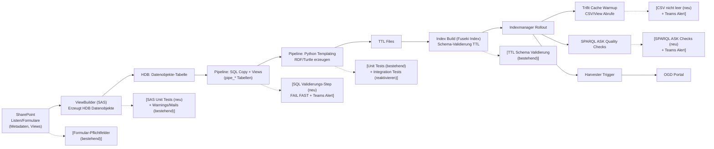

# Test & Qualitäts-Strategie LOD Pipeline

---

## Warum machen wir das?

Aktuell besteht die Pipeline aus mehreren komplexen Komponenten (HDB, ViewBuilder, SQL-Pipeline, RDF-Generierung, Index, Harvester). Fehler werden oft **erst sehr spät entdeckt** (nach mehreren Stunden Pipeline-Laufzeit oder erst im OGD-Portal).

Das führt zu:
- langen Feedback-Zyklen (mehrere Stunden)
- aufwendigem manuellem Debugging
- schwer nachvollziehbaren Fehlerquellen
- hoher Abhängigkeit von externen Prozessen

### 🎯 Ziel
- **Fail Fast** → Fehler möglichst früh erkennen
- **Automatisierte Tests statt manueller Checks**
- **Schnellere Development Loops**
- **Mehr Stabilität im Gesamtsystem**

---

## Scope vs. Out of Scope

### ✅ In Scope (dieses Vorhaben)
- Pipeline (Python + SQL)
- ViewBuilder (SAS)
- Integration Tests / Unit Tests
- Datenqualitäts-Checks innerhalb der Pipeline
- RDF / SPARQL Validierung
- Trifid / CSV Checks

---

### ❌ Out of Scope (wichtig!)

#### HDB Daten & HDB Fehler
- Fehler in den **HDB-Daten selbst** (z.B. falsche Inhalte, falsche Werte) 
    Im Rahmen des HDB-Prozess werden derzeit folgende Qualitätsprüfungen durchgeführt:
    - QS_Dubletten
    - QS_FehlendeCodes
    - QS_FehlendeKennzahl
    - QS_FehlenderRaum
    - QS_FehlendeZeit
    - QS_FehlendeMetadaten
    - QS_FehlerFormatWert
    - QS_Fussnoten
    - QS_FehlerZeitbereich
    - QS_StadtKreisQuartierZone
    - QS_DimensionSumme
- **Strukturprobleme** von HDB-Listen
    - manuelle Anpassungen an Tabellen sind schwer oder nicht nachvollziehbar
    - QS-Checks nur für HDB-Daten selbst, nicht für Metadatenlisten 
- HDB Metadatenverwaltung
    - Qualität der Excel-Inputs / HDB-Listen 
    - alternatives System ist Thema eines separates Projekts

👉 Diese werden **nur erkannt**, aber **nicht hier gelöst**

**Konsequenz:**
- Wir bauen Checks wie:
    - „Wert ist vorhanden“
    - „Typ ist korrekt“
- aber nicht:
    - „Ist fachlich korrekt“

👉 Fehlerhandling:
- Pipeline schlägt früh fehl (fail fast)
- verantwortliche Stellen müssen HDB korrigieren

---

## Verantwortlichkeiten

---

### 1. Integration Tests (Pipeline)
**Owner:** Thomas

**Inhalt:**
- Integration-Test-Infrastruktur reaktivieren
- Docker Setup prüfen / fixen
- Minimalen Beispiel-Test erstellen:
    - kleine Testdatenbasis
    - Pipeline-Step ausführen
    - Output validieren

**Ziel:**
- Automatisierte Prüfung von Pipeline-Verhalten
- Grundlage für weitere Tests

---

### 2. Unit Tests (Pipeline)
**Owner:** Neven

**Inhalt:**
- Bestehende Unit-Tests in `tests/unit/` erweitern
    - einzelne Steps isoliert, DB und Fuseki gemockt (läuft in CI)
- Optimierten Pfad (aktiv in int/prod) abdecken:
    - Templating (`TemplatingOptimized`, `GroupedTemplatingOptimized`)
    - GZIP-Output: Vollständigkeit und Struktur der Batch-Dateien
- Tests für bisher ungetestete Steps ergänzen (z.B. `InitPipeTables`, `WritePublicationStatiToHDB`)

**Besonderheit:**
- Aktuell:
    - Unit-Tests decken nur den Standardpfad ab
    - optimierter Pfad (Produktion) ungetestet → Fehler erst bei Fuseki/OGD sichtbar

**Ziel:**
- Fehler in einzelnen Pipeline-Steps früh erkennen, ohne vollständigen Pipeline-Lauf
- Abdeckung des in Produktion genutzten Codepfads

---

### 3. SAS / ViewBuilder Tests
**Owner:** Selma

**Inhalt:**
- Analyse der bestehenden Möglichkeiten für Tests im SAS ViewBuilder
- Evaluierung:
    - Wie können Unit Tests für SAS implementiert werden?
    - Welche Teile sind sinnvoll testbar?
- Implementierung erster Tests:
    - Pflichtfelder / leere Felder
    - einfache Logikprüfungen

**Besonderheit:**
- Aktuell:
    - inhaltliche Checks vorhanden (Warnings / Errors / E-Mails)
    - aber keine echten automatisierten Tests der Codebasis

**Ziel:**
- Systematische Testbasis im ViewBuilder
- Weg von reinem E-Mail-/Log-basiertem Feedback bzw. Adaption der Notifizierung

---

### 4. SQL Datenvalidierung in Pipeline
**Owner:** Jakob

**Inhalt:**
- Neuer Pipeline-Step nach Aufbau der Pipe-Tabellen
- SQL-basierte Checks:
    - Datentypen
    - NULL-Werte
    - Feldformate (z.B. IDs)
- Nutzung von Fehlermechanismen auf SQL-Ebene (`RAISERROR`)
  oder via inhaltlicher Validierung in der Pipeline.

**Ziel:**
- Früher Abbruch bei fehlerhaften Daten
- Vermeidung von Fehlern in späteren Pipeline-Stufen

---

### 5. Trifit / CSV Checks
**Owner:** Jakob

**Inhalt:**
- Trifit Cache befüllen
  - Nach dem "Rollout" eines neuen Fuseki-Index, wird _vor_ dem Harvesting vom rollout-script getriggert.
- einfache Validierungen:
    - CSV nicht leer
    - Views liefern Ergebnisse

**Ziel:**
- Sicherstellen, dass Daten überhaupt im OGD ankommen

---

### 6. SPARQL / RDF Qualitätschecks
**Owner:** Jakob

**Inhalt:**
- SPARQL ASK Queries definieren:
    - Daten vorhanden
    - Pflichtfelder vorhanden
- Integration nach Index/Load, vor dem CSV-Check

**Wichtig:**
- keine exakten Anzahlprüfungen (instabil)
- stattdessen:
    - Existenzprüfungen
    - Strukturprüfungen

**Ziel:**
- Validierung auf RDF-Ebene

---

### 7. Harvester Unit Tests
**Owner:** ?

**Inhalt:**

- Harvester Plugin im OGD/CKAN Umfeld nicht direkt von uns kontrolliert
- aber: wird von uns angepasst z.B. bei Änderungen an View-Struktur oder RDF Properties
- Aktuell schwer testbar / Fehler erst im laufenden System ersichtlich

**Ziel:**
- minimale Testbarkeit des Plugins durch Unit-Tests

### 8. Test-Guidelines & DoD
**Owner:** Team (Koordination: Thomas)

**Inhalt:**
- Definition:
    - wann Tests geschrieben werden müssen
- Integration in Definition of Done:
    - Änderung → Test Pflicht

**Ziel:**
- Nachhaltige Teststrategie

---

### 9. Cleanup & Infrastruktur
**Owner:** Team

**Inhalt:**
- Alte / nicht laufende Tests prüfen
- CLI / Runner Struktur bereinigen
- Dokumentation aktualisieren

---

## GitLab Ticket Template

### 📝 Titel
`[TEST] <kurze Beschreibung>`

---

### 📄 Beschreibung / Zusammenfassung
- Was ist das Problem?
- Warum ist das relevant?
- Welcher Teil der Pipeline ist betroffen?

---

### ✅ Akzeptanzkriterien

Beispiel:
- [ ] Test implementiert
- [ ] Test läuft lokal oder in CI
- [ ] Test schlägt fehl bei falschen Daten
- [ ] Test ist dokumentiert

---

### ⚠️ Abgrenzung
- Keine HDB Datenbereinigung
- Keine fachliche Validierung der Inhalte

---

### 📊 Definition of Done
- Code implementiert
- Tests vorhanden
- CI läuft grün
- Dokumentation aktualisiert

---

## Zusammenfassung – wichtigste Schritte

1. Integration Tests aktivieren (Startpunkt)
2. Unit Tests der Pipeline erweitern (v.a. optimierter Pfad / GZIP-Output)
3. SAS/ViewBuilder Testbarkeit aufbauen (Selma)
4. SQL Validierung einführen (fail fast)
5. RDF & CSV Checks ergänzen
6. Harvester Code Unit-Tests
7. Guidelines definieren

👉 Ziel: Fehler so früh wie möglich erkennen und Pipeline stabilisieren
``
